<h1 align="center">NolaniOS</h1>

<p align="center">
  <b>A self-hosted workspace in the browser, with an assistant that can operate its apps.</b>
</p>

<p align="center">
  <a href="#run-your-own-cell">Self-host</a> ·
  <a href="ROADMAP.md">Roadmap</a> ·
  <a href="https://github.com/nolani-os/nolani/discussions">Discussions</a> ·
  <a href="CONTRIBUTING.md">Contribute</a>
</p>

<p align="center">
  <a href="LICENSE"></a>
  <a href="https://github.com/nolani-os/nolani/actions/workflows/ci.yml"></a>
  
</p>

<p align="center">
  <a href="docs/assets/agent.mp4"></a>
  <br><sub>Nolani at work, in the Shore look (sped up; click for the video in real time)</sub>
</p>

NolaniOS gives you files, office documents, mail, calendar, tasks, team chat and video calls,
photos, scanned documents, passwords and a knowledge base on one server of your own. You use
them in a single desktop in the browser, on the laptop and on the phone, with one login.

The assistant, Nolani, can do things in these apps for you. Ask it to open next week in the
calendar, to add a task and show it, or to add a section to the document you have open, and
you see it happen on screen.

## What it does for you

- **Nolani works in the apps.** It opens windows, jumps to a task or a file, writes into the
  open document and checks the screen afterwards. It acts with your permissions, never as an
  administrator.
- **Nothing goes out without your click.** Posting, sending and other irreversible actions
  need a confirmation button. A "yes" in the chat is not enough, because chat text can be
  manipulated.
- **Your files, mail and calendars stay on your server.** What you write to Nolani is sent to
  the language model you configure and, when it operates the apps, to the hosted agent
  runtime (see [The assistant](#the-assistant)).
- **One workspace instead of many logins.** All apps share one sign-in and one desktop.
- **Free software.** AGPL-3.0. NolaniOS sends no telemetry, and setup switches it off in the
  bundled services where they offer a switch.

<table>
  <tr>
    <td>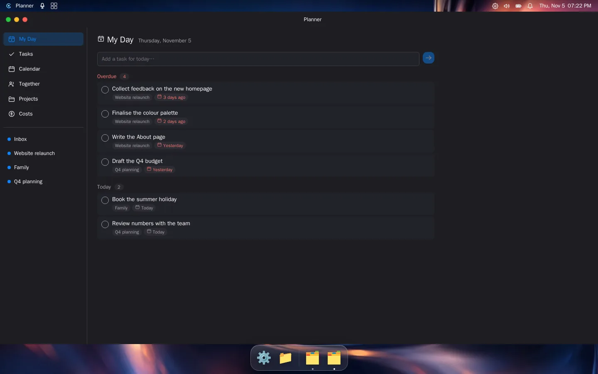<br><b>Planner</b>: tasks, calendar, Gantt</td>
    <td>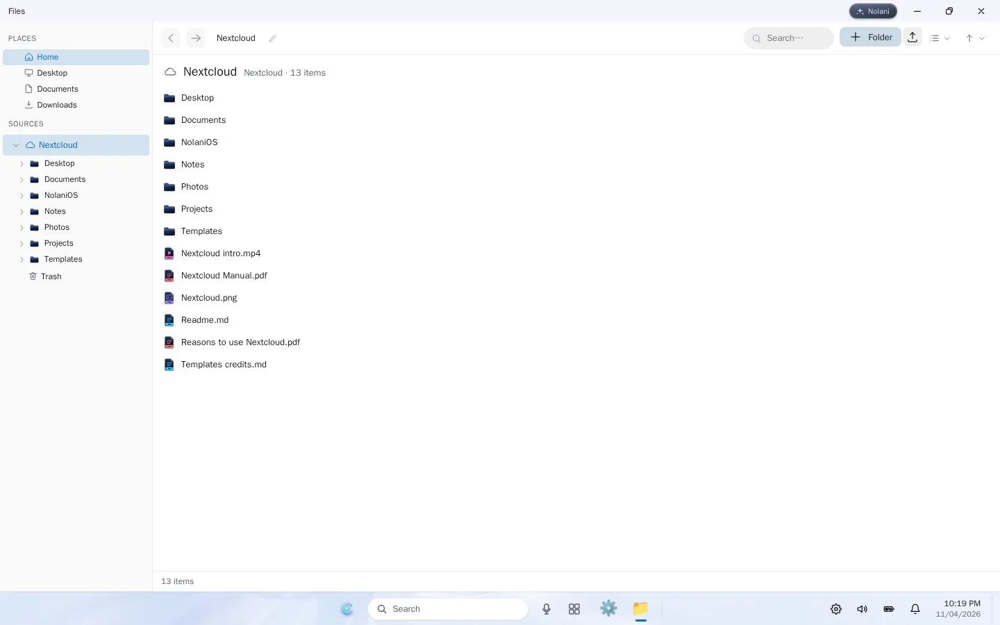<br><b>Files and office</b>: Nextcloud and Collabora</td>
  </tr>
  <tr>
    <td>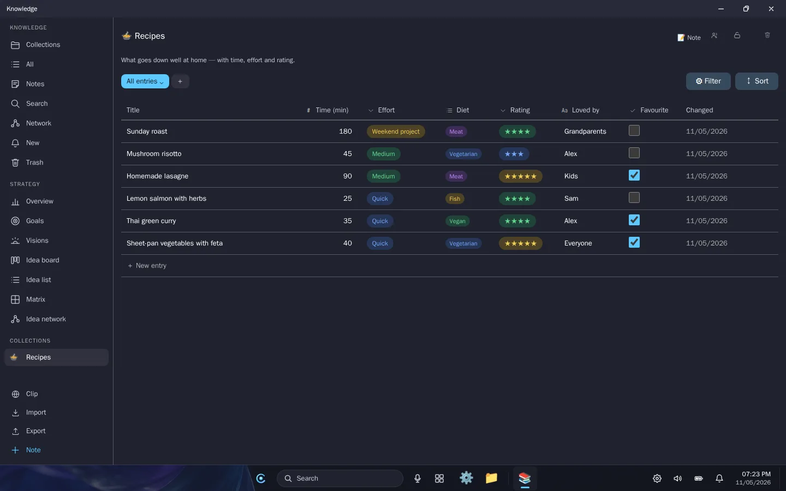<br><b>Knowledge</b>: collections as tables, boards and calendars</td>
    <td>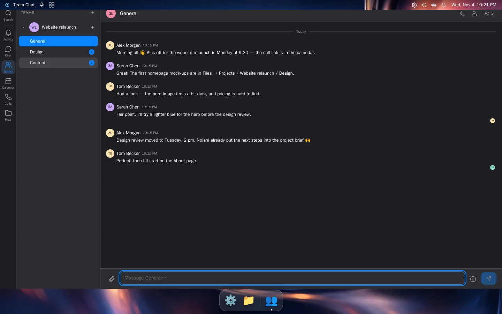<br><b>Teams</b>: chat, channels and calls</td>
  </tr>
  <tr>
    <td>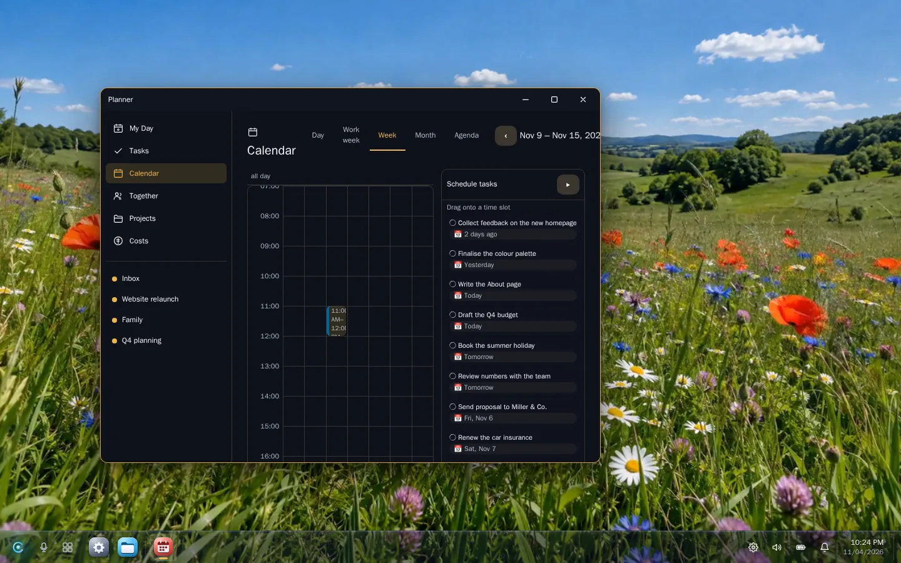<br><b>Nolani</b> adds a task and shows it to you</td>
    <td align="center">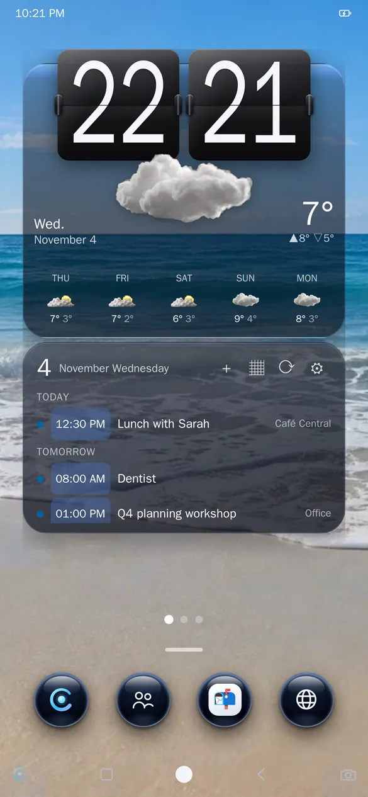 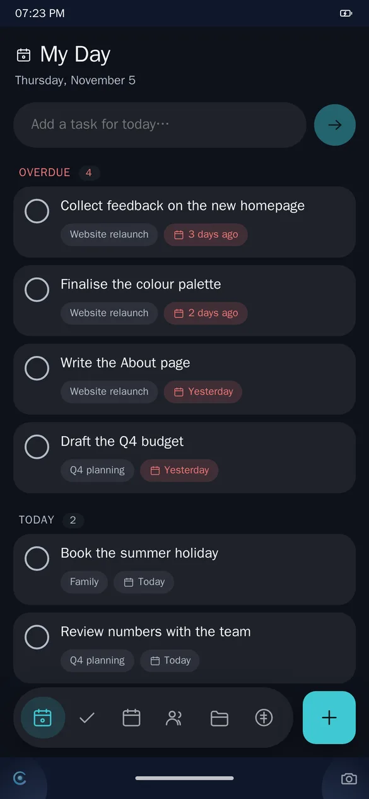<br><b>Mobile</b>: the same workspace on the phone</td>
  </tr>
</table>

## What is included

| App | What you can do | Built on |
|---|---|---|
| Desktop and mobile shell | Windows, taskbar, start menu, widgets, notifications | NolaniOS |
| Nolani (assistant) | Let it operate the apps, ask about your data, run routines | NolaniOS, with a language model of your choice |
| Files and office | Browse and share files, edit Word, Excel and PowerPoint files in the browser | Nextcloud, Collabora Online |
| Mail | Inbox with rules, turn a mail into a task, event or note | Stalwart |
| Planner | Tasks, projects, calendar, Gantt, time and costs | Vikunja, Nextcloud calendar |
| Teams | Chat, channels, video calls | Matrix (Synapse), LiveKit, Element Call |
| Knowledge and ideas | Pages, collections as tables or boards, idea board | NolaniOS |
| Photos | Timeline, albums, face recognition | Immich |
| Documents | Scans with text recognition, tags, full-text search | Paperless-ngx |
| Passwords | Personal and shared vaults | Vaultwarden |
| Personal browser | A browser in a window; downloads land in your files | Selkies, Chromium |
| Social (optional) | Your own Mastodon and PeerTube | Mastodon, PeerTube |
| Business apps (optional) | ERP/CRM, parts and stock, dashboards, marketing automation, HR — each a tile with single sign-on, Nolani can work in Odoo for you | Odoo, InvenTree, Apache Superset, Mautic, OrangeHRM |

Apps marked NolaniOS are written in this repository. The others run unchanged in their own
containers; NolaniOS signs you in to them, creates your accounts there and gives Nolani tools
to use them.

## Looks

<p align="center">
  <a href="docs/assets/looks.mp4">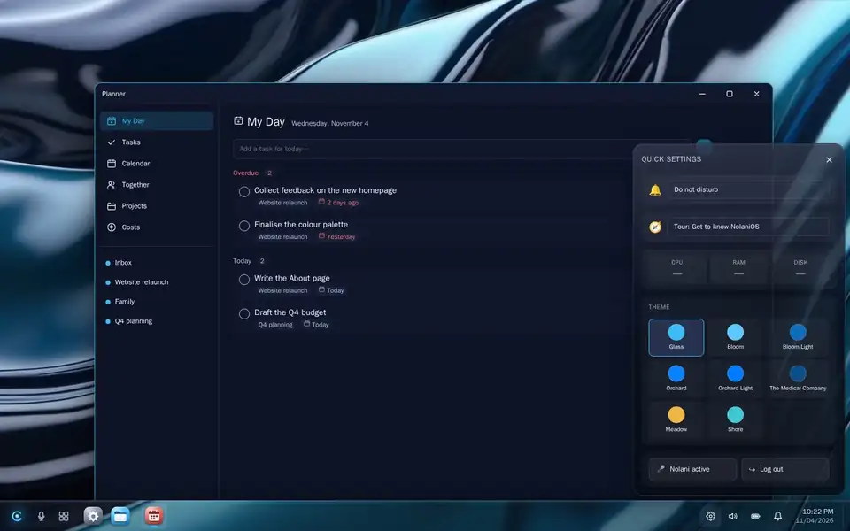</a>
</p>

The desktop comes in six looks (`packages/skins`), each switched in the quick settings:
Glass, Bloom, Orchard (light and dark), the living photos Meadow and Shore (a looping video
with a sky that follows the real sun), and a corporate template that derives a company's
skin from two colours and a logo. The look follows the account to every device.

<table>
  <tr>
    <td>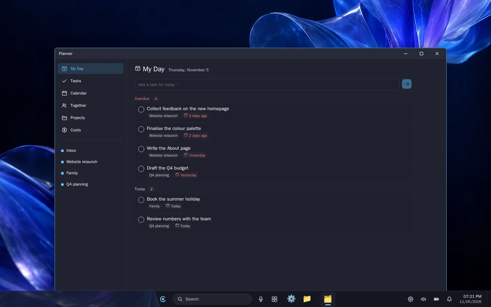<br>Bloom</td>
    <td>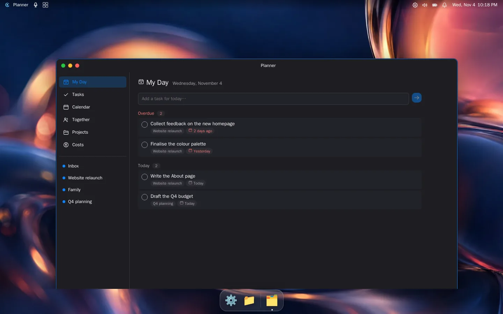<br>Orchard</td>
    <td>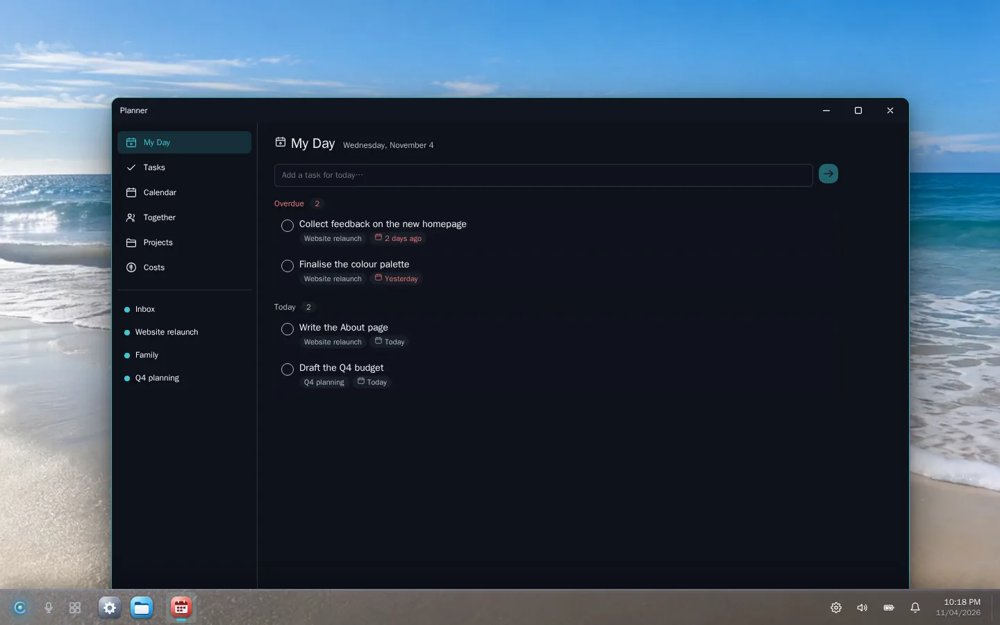<br>Shore (living photo)</td>
  </tr>
</table>

## Business apps

<p align="center">
  <a href="docs/assets/nolani-business.mp4">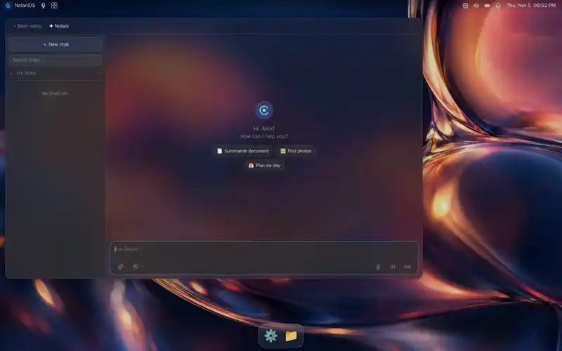</a>
  <br><sub>Nolani at work in Odoo, Mautic and InvenTree (sped up; click for the video in real time)</sub>
</p>

Five optional apps for a company, each a tile on the desktop: **Odoo** (contacts, ERP/CRM),
**InvenTree** (parts and stock), **Apache Superset** (dashboards), **Mautic** (contacts,
campaigns, newsletters) and **OrangeHRM** (employees, leave, time). Switch them on with
`./setup.sh <domain> --apps odoo,inventree,superset,mautic,orangehrm`. Every user signs in
once at the desktop; an account in the app is created on the first visit, with ordinary
user rights (in Superset, the cell's administrators get its admin role).

Nolani works in three of them for you, always with your own account and rights:

- **Odoo**: find contacts and records, create companies and their contacts, write a note into
  a contact's history, create an opportunity in the CRM pipeline.
- **Mautic**: find and add contacts, build a segment, draft emails to it, build a simple
  campaign. Nothing is sent or published — that stays your click in Mautic.
- **InvenTree**: find parts and what runs low, create a part with stock, book stock in and
  out, draft a purchase order at a supplier.

<table>
  <tr>
    <td>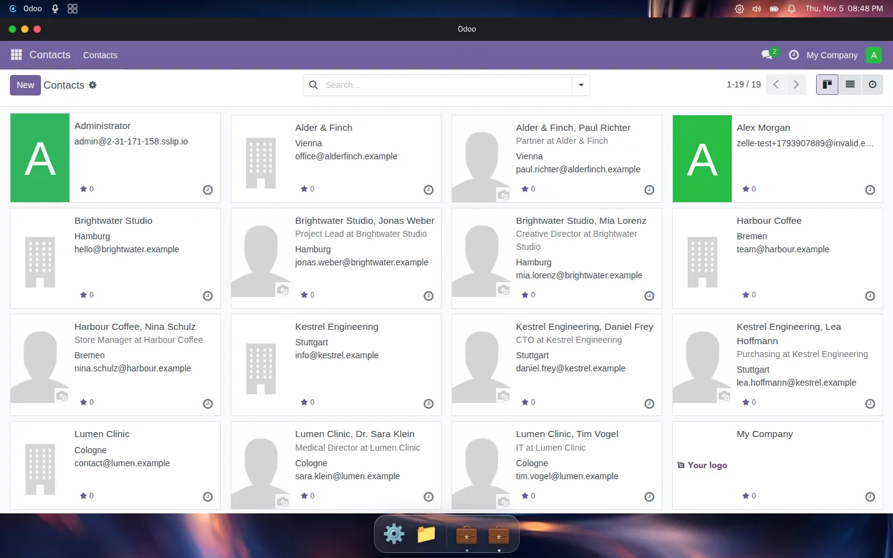<br><b>Odoo</b>: contacts and companies</td>
    <td>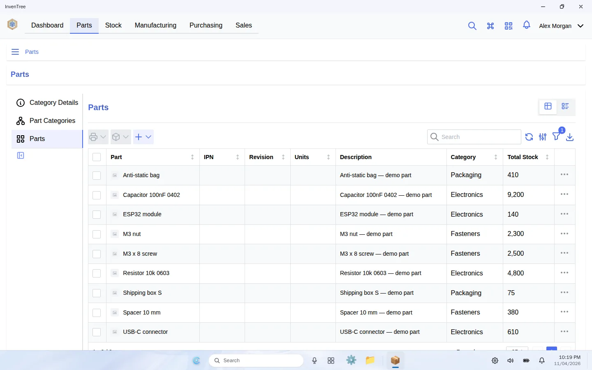<br><b>InvenTree</b>: parts and stock</td>
  </tr>
  <tr>
    <td>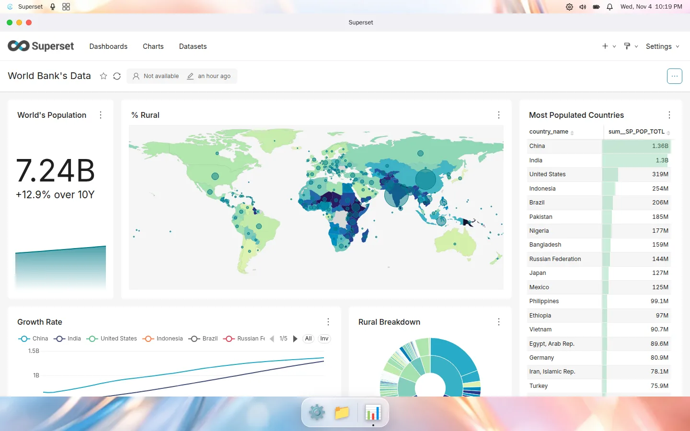<br><b>Superset</b>: dashboards (example data)</td>
    <td>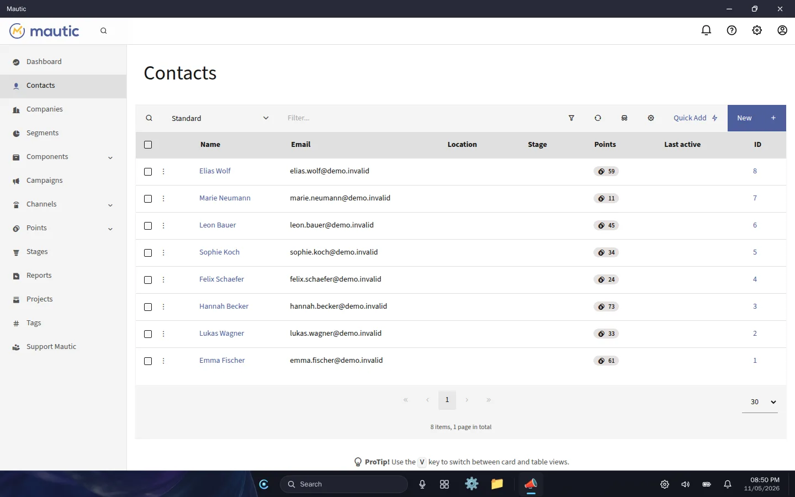<br><b>Mautic</b>: contacts and campaigns</td>
  </tr>
  <tr>
    <td>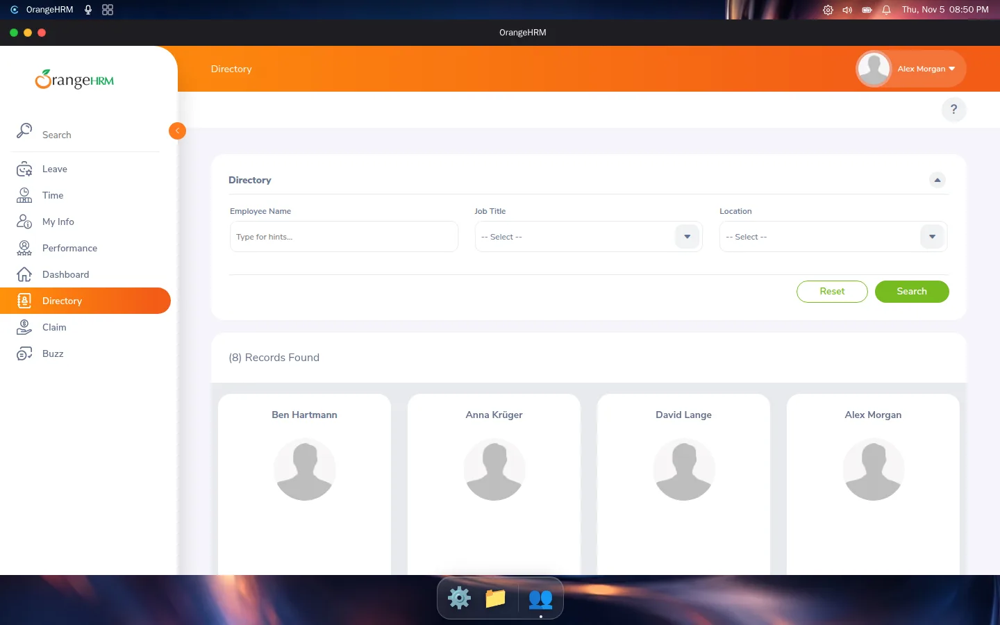<br><b>OrangeHRM</b>: employee directory, self-service</td>
    <td></td>
  </tr>
</table>

The data in these pictures is invented (`deploy/cell/seed_business.sh`).

## Nolani Knowledge, without a server

The knowledge app also exists on its own: notes, pages and databases (tables, boards, filters,
formulas, relations) that live on your device only, with no server and no account. It runs on
Linux, Windows and Android and uses the same views as the knowledge app in NolaniOS, answered
by a local SQLite database. On the desktop, a local HTTP API (off by default, loopback only,
with a key) lets your own scripts and agents use it.

Download it from the [releases](https://github.com/nolani-os/nolani/releases) (tags
`knowledge-v*`); the Android package is signed, the Windows installer is not yet. Details,
the API and the tests are in [`packages/app-knowledge`](packages/app-knowledge/README.md).

## Companion apps for Windows, Linux and Android

`packages/desktop` (Tauri + a Go daemon) and `packages/android` put your Nolani server in its
own window on the device, with push notifications and an optional tunnel to a server that is
not publicly reachable. The generic builds connect to any server by address. They are built
by CI (`.github/workflows/companion-apps.yml`); releases are tagged `companion-v*`. Details in
[`packages/desktop/README.md`](packages/desktop/README.md) and
[`packages/android/README.md`](packages/android/README.md).

## One installation, one server

An installation is called a *cell*: one server with its own accounts and data. Cells are
independent of each other. Team chat stays inside the cell; Mastodon and PeerTube connect only
to servers the administrator approves one by one. Cells cannot be connected with each other
yet.

## The assistant

Nolani uses any language model through LiteLLM: Anthropic, OpenAI-compatible providers or a
local model. The tools it may use are declared per app in [`clara-tools.d/`](clara-tools.d),
one YAML file per app, and every call runs as the signed-in user.

- **Agent runtime.** To operate the apps, Nolani needs an agent runtime that plans and calls
  the tools. It is not part of this repository; we run it as a hosted preview for cells.
  Without it, Nolani is a plain chat assistant and tells you so.
- **Bring your own agent.** Any MCP-capable agent (Claude Desktop, an IDE, your own) can use a
  cell's app tools through its MCP endpoint, with per-user keys and read or write scopes
  (`./setup.sh <domain> --mcp`).

## Run your own cell

You need one Linux server (tested: **8 vCPU, 16 GB RAM, 160 GB disk, Debian 13**) with Docker,
a user with `sudo` rights in the `docker` group, and a domain whose `<domain>` and
`*.<domain>` records point to the server.

```bash
git clone https://github.com/nolani-os/nolani.git /opt/claraos/src
cp -r /opt/claraos/src/deploy/cell/. /opt/claraos/
cd /opt/claraos
./setup.sh your-domain.example     # builds, starts, sets up sign-in and every app
./run_tests.sh                     # end-to-end checks with a throw-away account
```

Pick the optional apps with `--apps` (`photos`, `documents`, `browser`, `office`, `teams`,
`odoo`, `inventree`, `superset`, `mautic`, `orangehrm`; `none` = only the core). The core needs
about 4 GB of RAM at idle; on an 8 GB test server the core plus all five business apps used
5.7 GB. The 16 GB server above runs everything. The choice is remembered, a later run with `--apps` replaces it.

`setup.sh` is idempotent and generates every secret **on the server** (`.env`, mode 0600).
Put your model key into `.env` as `ANTHROPIC_API_KEY` (other providers via
`deploy/cell/litellm.yaml`). Then open `https://home.<domain>`; the first administrator is
`akadmin` (password in `.env`), who creates the other accounts under *User admin*.

- Server on Hetzner Cloud with OpenTofu: [`deploy/terraform/hetzner-cell`](deploy/terraform/hetzner-cell)
- Backups run nightly (systemd timer); restore: [`deploy/cell/RESTORE.md`](deploy/cell/RESTORE.md)
- Rename the product and the assistant for your installation: `CLARAOS_PRODUCT_NAME`,
  `CLARAOS_ASSISTANT_NAME` in `.env` (defaults: NolaniOS, Nolani)
- The API verifies every outgoing TLS connection. Services with an internal CA: point
  `CLARAOS_TLS_CA` at a PEM bundle; `CLARAOS_TLS_VERIFY=0` switches verification off
  altogether (not recommended). The mail server's internal certificate is the one exception
  `setup.sh` writes itself (`MAIL_TLS_VERIFY=false`).

## Repository layout

```
packages/
  shell/       the web shell and its built-in apps (React, TypeScript, Vite)
  core/        shared types, stores, domain helpers
  skins/       themes, icons
  api/         FastAPI backend: routers, services, migrations
  app-knowledge/ standalone Knowledge app (Tauri: Linux, Windows, Android)
clara-tools.d/ the assistant's tools, one YAML file per app
deploy/
  cell/        Docker Compose stack + setup, backup, restore and test scripts
  terraform/   OpenTofu module for a cell on Hetzner Cloud
docker/        Dockerfiles for the API and the frontend
```

## Status and known rough edges

**Early preview.** Good for yourself, your family or a small team. Not yet for customers.

- **Languages:** English and German. A few texts may still appear in German; please report
  them.
- **Old name:** NolaniOS used to be called ClaraOS. Internal names still carry it (package
  scope `@claraos/*`, API prefix `/api/claraos`, `CLARAOS_*` variables, `claraos_*` tables).
  You do not see them in the interface, and they are renamed step by step.
- **Size:** a cell runs about 40 containers. A smaller setup for one person is on the roadmap.
- **How it is made:** one maintainer with AI coding agents. Every change goes through tests,
  a secret scan and an end-to-end run on a real cell.

## Contributing

Issues and pull requests are welcome. Good starting points are the
[good first issues](https://github.com/nolani-os/nolani/labels/good%20first%20issue) and the
[roadmap](ROADMAP.md); please read [CONTRIBUTING.md](CONTRIBUTING.md) first. Translations are
especially welcome.

## Services with their own terms

The cell pulls these images unchanged; their licences apply to them, not to this repository:

- **Collabora Online CODE** is the development edition (MPL-2.0, with Collabora's trademarks
  and an unsupported-version notice). For production or commercial use, consider a Collabora
  Online subscription.
- **Open WebUI** uses a BSD-3-Clause licence with a branding clause: installations with more
  than 50 users in 30 days must keep the "Open WebUI" branding or obtain an enterprise
  licence. NolaniOS talks to its API from its own chat UI; check whether this applies to you.
- **Stalwart, Authentik and LiteLLM** ship optional enterprise features under separate
  licences. A cell uses none of them and sets no licence keys.
- **Redis-compatible cache:** the cell uses Valkey (BSD-3-Clause).
- **Optional business apps** (`setup.sh --apps …`): **Odoo Community** (LGPL-3.0) with the
  OCA module `auth_oidc` (AGPL-3.0) added at build time; **InvenTree** (MIT); **Apache
  Superset** (Apache-2.0, plus `psycopg2` and `authlib` added at build time); **Mautic**
  (GPL-3.0); **OrangeHRM** (GPL-3.0 — two files of its OpenID plugin are replaced by modified
  copies that live in this repository, see `THIRD_PARTY_NOTICES.md`). Each keeps its own
  licence and, where it has one, its own trademark policy.

## Security

Please do not open public issues for security problems. See [SECURITY.md](SECURITY.md).

## Trademarks

"Nolani" and "NolaniOS" are names of this project. Names and logos of other products
(Nextcloud, Immich, Mastodon, Element, Vaultwarden, Paperless-ngx, PeerTube, Authentik,
Open WebUI and others) are trademarks of their respective owners and are used only to
identify those products; no endorsement is implied. See
[THIRD_PARTY_NOTICES.md](THIRD_PARTY_NOTICES.md).

## License

Copyright © 2025–2026 the NolaniOS authors (see the Git history).

NolaniOS is licensed under the **GNU Affero General Public License v3.0 or later**, see
[LICENSE](LICENSE). If you run a modified version as a network service, the AGPL requires you
to offer its source code to the users of that service; set `CLARAOS_SOURCE_URL` so the
shell's "About" page links to your source. Bundled third-party components keep their own
licences, see [THIRD_PARTY_NOTICES.md](THIRD_PARTY_NOTICES.md).
