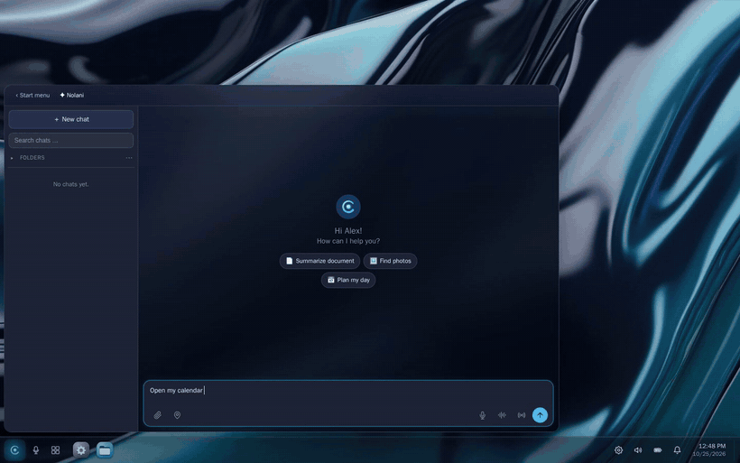
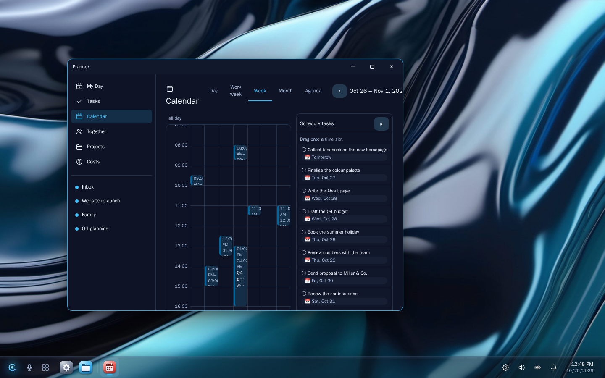
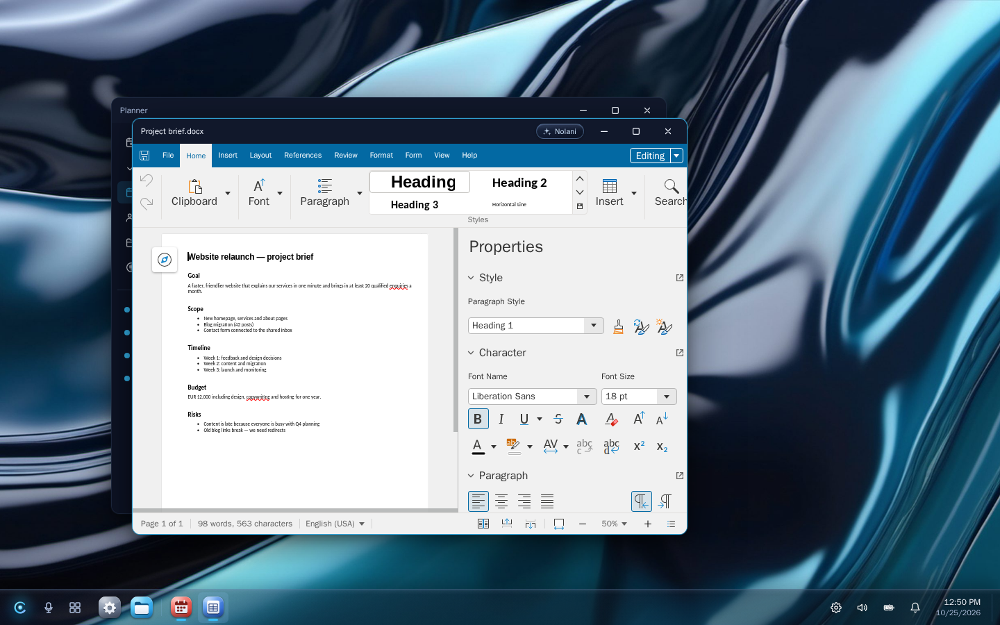
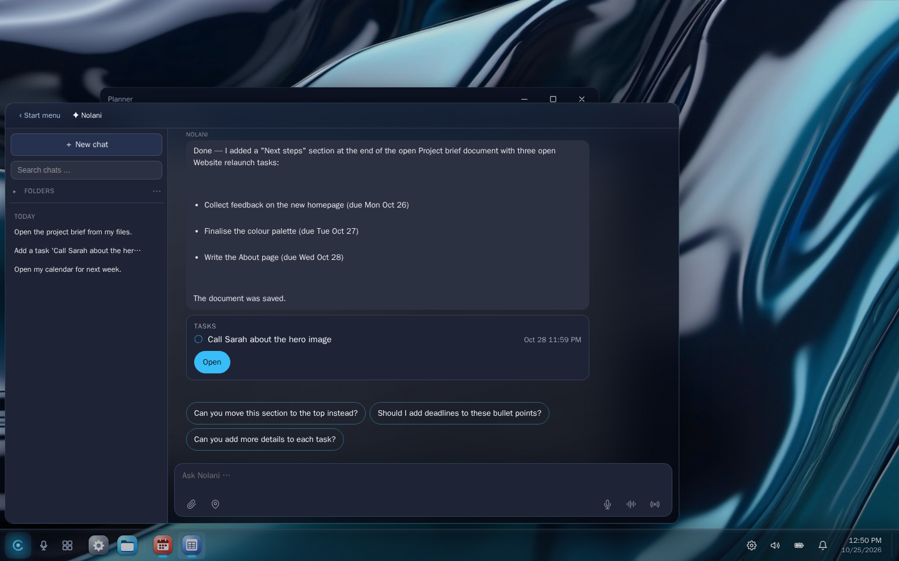
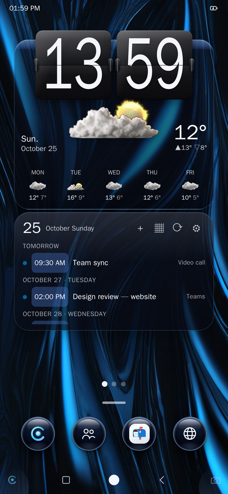
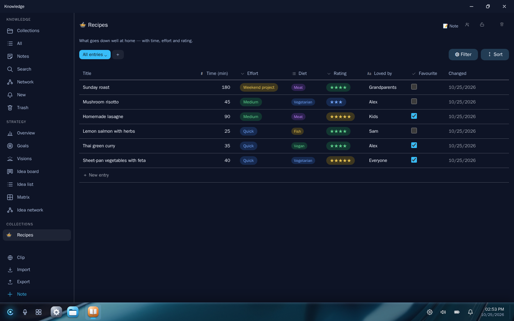
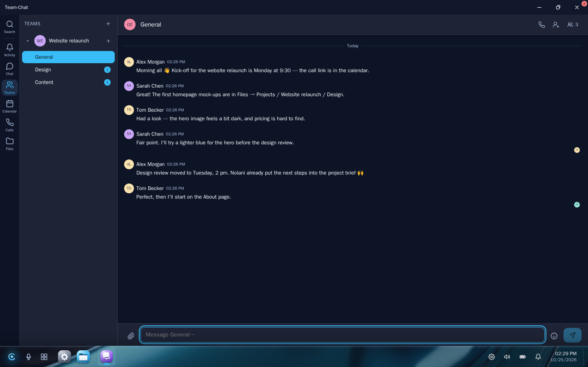

<h1 align="center">NolaniOS</h1>

<p align="center">
  <b>The open-source, self-hosted alternative to Google Workspace + Copilot —<br>
  with an AI agent that actually operates your apps.</b>
</p>

<p align="center">
  <a href="#run-your-own-cell">Self-host</a> ·
  <a href="ROADMAP.md">Roadmap</a> ·
  <a href="https://github.com/nolani-os/nolani/discussions">Discussions</a> ·
  <a href="CONTRIBUTING.md">Contribute</a>
</p>

<p align="center">
  <a href="LICENSE"></a>
  <a href="https://github.com/nolani-os/nolani/actions/workflows/ci.yml"></a>
  
</p>

<p align="center">
  
</p>

**NolaniOS** is a desktop in your browser — files, office, mail, calendar and tasks, chat and
video calls, photos, documents, passwords, a knowledge base — running on **your own server**.
Built in is **Nolani**, an assistant that doesn't just answer: ask it to *open the calendar*,
*add a task for Friday and show it to me* or *write a summary into the open document*, and
you watch it happen on screen.

## Why NolaniOS

- **An agent that works the apps, not a chatbot next to them.** Nolani uses the same tools as
  you do — it opens windows, jumps to records, opens files in the right viewer, writes into
  the document you have open, and reads what is on screen to check its own work.
- **Your data stays on your server.** One installation — a *cell* — is one server and one
  trust boundary. Nothing is shared between cells.
- **Guard rails built in.** Anything public or irreversible (posting, sending) needs your
  approval by button — a "yes" in the chat is not enough, because a chat can be manipulated.
- **One coherent workspace.** Single sign-on across all apps, one desktop on laptop and phone.
- **Free software.** AGPL-3.0. NolaniOS itself sends no telemetry, and the cell switches it off
  in the bundled services that offer a switch.

<table>
  <tr>
    <td><br><b>Planner</b> — tasks, calendar, Gantt</td>
    <td><br><b>Files & office</b> — Nextcloud + Collabora</td>
  </tr>
  <tr>
    <td><br><b>Nolani</b> — operates the apps for you</td>
    <td><br><b>Mobile</b> — the same workspace on the phone</td>
  </tr>
  <tr>
    <td><br><b>Knowledge</b> — collections as tables, boards and calendars</td>
    <td><br><b>Teams</b> — chat, channels and calls (Matrix + LiveKit)</td>
  </tr>
</table>

## What you get

| App | What it does | Built on |
|---|---|---|
| Desktop & mobile shell | Windows, taskbar, start menu, widgets, notifications | **NolaniOS** (React, TypeScript) |
| Nolani (assistant) | Operates the apps, answers with your data, routines | **NolaniOS** + an LLM of your choice via LiteLLM |
| Files & office | Browse, share, edit Word/Excel/PowerPoint in the browser | Nextcloud, Collabora Online |
| Mail | Inbox with rules, mail → task / event / note | Stalwart (JMAP) |
| Planner | Tasks, projects, calendar, Gantt, time and cost tracking | Vikunja + Nextcloud calendar |
| Teams | Chat, rooms, video calls | Matrix / Synapse, LiveKit, Element Call |
| Knowledge & ideas | Pages, collections, idea board | **NolaniOS** |
| Photos | Timeline, albums, face recognition | Immich |
| Documents | Scans with OCR, tags, full-text search | Paperless-ngx |
| Passwords | Personal and shared vaults | Vaultwarden |
| Personal browser | A browser streamed into the shell, downloads land in Files | Selkies / Chromium |
| Social (optional) | Your own Mastodon and PeerTube | Mastodon, PeerTube |

### What is our own code — and what is integration

NolaniOS is about 130,000 lines of its own code: the **shell** (desktop, mobile, built-in apps
such as planner views, knowledge base and file manager — `packages/shell`, `packages/core`),
the **API** that ties everything together (identity, per-user app access, the tool gateway
the assistant uses, routines — `packages/api`), and the **cell operations** (setup, backups,
restore, end-to-end tests, OpenTofu — `deploy/`). The apps in the table above that name another
project run unchanged as containers; NolaniOS signs users in to them, provisions their
accounts and gives the assistant tools for them.

## The assistant

Nolani talks to any model through LiteLLM (Anthropic, OpenAI-compatible, local models). The
tools it can use are declared per app in [`clara-tools.d/`](clara-tools.d) — one YAML file
per app — and every call runs as the signed-in user, never as an admin.

- **Agent runtime.** Operating the apps needs an *agent runtime* (the "brain") that plans and
  calls the tools. It is **not part of this repository**; we run it as a **hosted preview**
  for cells. Without it, Nolani is a plain chat assistant and says so honestly.
- **Bring your own agent.** Any MCP-capable agent (Claude Desktop, IDEs, your own) can use a
  cell's app tools through its MCP endpoint, with per-user keys and read/write scopes
  (`./setup.sh <domain> --mcp`).

## Run your own cell

You need one Linux server (tested: **8 vCPU, 16 GB RAM, 160 GB disk, Debian 13**) with Docker,
a user with `sudo` rights in the `docker` group, and a domain whose `<domain>` and
`*.<domain>` records point to the server.

```bash
git clone https://github.com/nolani-os/nolani.git /opt/claraos/src
cp -r /opt/claraos/src/deploy/cell/. /opt/claraos/
cd /opt/claraos
./setup.sh your-domain.example     # builds, starts, sets up sign-in and every app
./run_tests.sh                     # end-to-end checks with a throw-away account
```

`setup.sh` is idempotent and generates every secret **on the server** (`.env`, mode 0600).
Put your model key into `.env` as `ANTHROPIC_API_KEY` (other providers via
`deploy/cell/litellm.yaml`). Then open `https://home.<domain>`; the first administrator is
`akadmin` (password in `.env`), who creates the other accounts under *User admin*.

- Server on Hetzner Cloud with OpenTofu: [`deploy/terraform/hetzner-cell`](deploy/terraform/hetzner-cell)
- Backups run nightly (systemd timer); restore: [`deploy/cell/RESTORE.md`](deploy/cell/RESTORE.md)
- Rename the product and the assistant for your installation: `CLARAOS_PRODUCT_NAME`,
  `CLARAOS_ASSISTANT_NAME` in `.env` (defaults: NolaniOS, Nolani)

## Repository layout

```
packages/
  shell/       the web shell and its built-in apps (React, TypeScript, Vite)
  core/        shared types, stores, domain helpers
  skins/       themes, icons
  api/         FastAPI backend: routers, services, migrations
clara-tools.d/ the assistant's tools, one YAML file per app
deploy/
  cell/        Docker Compose stack + setup, backup, restore and test scripts
  terraform/   OpenTofu module for a cell on Hetzner Cloud
docker/        Dockerfiles for the API and the frontend
```

## Status and known rough edges

**Early preview.** Run it for yourself, your family or your team — not yet for customers.

- **Languages:** the shell frame is German and English; the apps are being translated from
  German (see the [roadmap](ROADMAP.md)). Code and documentation are English.
- **Old name:** NolaniOS was called ClaraOS. Internal identifiers still carry it — package
  scope `@claraos/*`, API prefix `/api/claraos`, `CLARAOS_*` variables, `claraos_*` tables and
  some module names. They are not user-visible and are renamed step by step.
- **Footprint:** a cell runs about 40 containers; a slimmer single-person setup is on the
  roadmap.

## How this was built

NolaniOS was built by one person with AI coding agents — the maintainer designs, directs,
reviews and tests; the agents write most of the code. It is the same idea the product is
about: people stay in charge, agents do the work. Every change goes through tests, a secret
scan and an end-to-end suite on a real cell.

## Contributing

Issues and pull requests are welcome — start with a
[good first issue](https://github.com/nolani-os/nolani/labels/good%20first%20issue) or the
[roadmap](ROADMAP.md), and read [CONTRIBUTING.md](CONTRIBUTING.md). Translations are
especially welcome.

## Services with their own terms

The cell pulls these images unchanged; their licences apply to them, not to this repository:

- **Collabora Online CODE** is the development edition (MPL-2.0, with Collabora's trademarks
  and an unsupported-version notice). For production or commercial use, consider a Collabora
  Online subscription.
- **Open WebUI** uses a BSD-3-Clause licence with a branding clause: installations with more
  than 50 users in 30 days must keep the "Open WebUI" branding or obtain an enterprise
  licence. NolaniOS talks to its API from its own chat UI; check whether this applies to you.
- **Stalwart, Authentik and LiteLLM** ship optional enterprise features under separate
  licences. A cell uses none of them and sets no licence keys.
- **Redis-compatible cache:** the cell uses Valkey (BSD-3-Clause).

## Security

Please do not open public issues for security problems — see [SECURITY.md](SECURITY.md).

## Trademarks

"Nolani" and "NolaniOS" are names of this project. Names and logos of other products
(Nextcloud, Immich, Mastodon, Element, Vaultwarden, Paperless-ngx, PeerTube, Authentik,
Open WebUI and others) are trademarks of their respective owners and are used only to
identify those products; no endorsement is implied. See
[THIRD_PARTY_NOTICES.md](THIRD_PARTY_NOTICES.md).

## License

Copyright © 2025–2026 the NolaniOS authors (see the Git history).

NolaniOS is licensed under the **GNU Affero General Public License v3.0 or later** — see
[LICENSE](LICENSE). If you run a modified version as a network service, the AGPL requires you
to offer its source code to the users of that service; set `CLARAOS_SOURCE_URL` so the
shell's "About" page links to your source. Bundled third-party components keep their own
licences — see [THIRD_PARTY_NOTICES.md](THIRD_PARTY_NOTICES.md).
